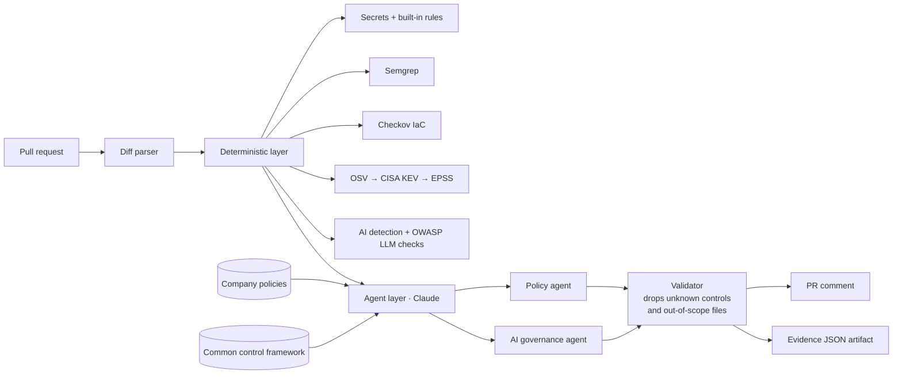

# 🔍 AuditLens

**Compliance-aware, AI-security-aware code review on every pull request.**

**[Live readiness dashboard](https://haneesha33.github.io/acme-support-app/)** · [Demo PRs](https://github.com/haneesha33/acme-support-app/pulls)

AuditLens reviews code changes against a company's own security policies and maps every issue to **SOC 2, ISO 27001, ISO 42001, NIST AI RMF and the OWASP Top 10 for LLM Applications**. It flags exploited vulnerabilities using **CISA KEV** and **EPSS**, detects new AI features and drafts the **AI inventory entry and impact assessment** they need, and saves an **audit evidence record** for every PR.

> GRC platforms check whether your *infrastructure* is configured correctly. Nothing checks whether the *code your developers write* follows *your written policies*, or whether a new AI feature just created an ISO 42001 obligation. AuditLens closes that gap and translates security requirements into fixes developers can act on.

---

## What a developer sees

On every PR, AuditLens posts one comment containing:

- **Verdict:** ❌ Blocking / ⚠️ Needs attention / ✅ Pass
- **Framework impact:** which SOC 2, ISO 27001, ISO 42001 and NIST AI RMF requirements the change affects
- **Security & policy findings:** each with the exact policy section, control mapping and a concrete fix
- **AI security findings:** prompt injection, PII sent to models, unsafe output handling, excessive agency, unbounded consumption, system prompt leakage (OWASP LLM01–LLM10)
- **Dependency risk:** new packages checked against OSV, ranked by **CISA KEV** (actively exploited) and **EPSS** (exploit likelihood)
- **AI governance actions:** register in AI inventory, complete impact assessment, confirm vendor approval, plus a **drafted impact assessment**

A JSON **evidence record** is uploaded as a workflow artifact: controls evaluated, pass/fail, findings and timestamp. That's direct audit evidence for change management (SOC 2 CC8.1 / ISO 27001 A.8.32).

## Architecture



### Design principles

1. **Deterministic first, LLM second.** Scanners and rules produce the facts. The LLM agents add context, policy reasoning and drafts. The core findings are reproducible without any AI.
2. **Grounded and validated LLM output.** Agents answer through a fixed JSON schema (forced tool use), must quote the policy sentence they rely on, and can only cite control IDs from the catalog. A validator drops anything that references unknown controls or files outside the change.
3. **Common control framework.** Each internal control (`AL-xx`) is written once and mapped to multiple frameworks, the same approach GRC platforms use to avoid testing overlapping requirements twice.
4. **Policies as input, not hardcoded rules.** Drop your own Markdown policies into `.auditlens/policies/` and the agents review against them.
5. **Transparent AI.** LLM-generated items are marked 🤖. The tool documents its own AI use (see [Self-assessment](#self-assessment)).

## Quick start

### 1. In the repo you want reviewed

Copy [`examples/auditlens-workflow.yml`](examples/auditlens-workflow.yml) to `.github/workflows/auditlens.yml` and add `ANTHROPIC_API_KEY` as a repository secret.

```yaml
- uses: actions/checkout@v4
  with:
    fetch-depth: 0
- uses: haneesha33/auditlens@main
  with:
    anthropic-api-key: ${{ secrets.ANTHROPIC_API_KEY }}
    fail-on: critical
```

Without an API key AuditLens still runs every deterministic check. Only the two agents are skipped.

### 2. Run locally

```bash
pip install -r requirements.txt
python -m auditlens --repo-path ../my-app --base main --dry-run          # full run, prints report
python -m auditlens --repo-path ../my-app --base main --offline          # no network at all
```

| Flag | Purpose |
|---|---|
| `--base` / `--head` | Refs to compare (defaults: `origin/$GITHUB_BASE_REF`, `HEAD`) |
| `--policies` / `--controls` | Custom policy folder / control catalog |
| `--no-llm` | Deterministic checks only |
| `--offline` | No OSV/KEV/EPSS/LLM/GitHub calls |
| `--fail-on` | `critical` (default), `high`, `medium`, `low`, `never` |

## Demo

`demo/setup_demo.sh` builds a fictional **Acme Support App** with three PR branches:

| PR | What it adds | What AuditLens catches |
|---|---|---|
| 1. S3 exports | Ticket export feature + Terraform | Hardcoded AWS key, SQL injection, public S3 bucket, wildcard IAM |
| 2. Reporting service | Legacy Java service + Python deps | `log4j-core 2.14.1` → CVE-2021-44228 **in CISA KEV**, plus other vulnerable packages ranked by EPSS |
| 3. AI support bot | LLM chatbot with tools | Prompt injection, PII sent to model, model output → shell, `run_shell` tool, prompt secrets, no token limit, no logging, plus ISO 42001 inventory/impact assessment/vendor review actions and a drafted impact assessment |

```bash
bash demo/setup_demo.sh haneesha33
# then push the branches and open three PRs
```

## Readiness dashboard

`python -m auditlens.dashboard` turns the per-PR evidence records into one self-contained HTML page:

- **Framework readiness** for SOC 2, ISO 27001, ISO 42001, NIST AI RMF and OWASP LLM: the share of in-scope controls with no open findings across open PRs, and which requirements are open
- **Control-by-PR matrix** showing each control as *fail / no findings / performed / not applicable* on each change
- **Open critical and high findings**, CISA KEV count, and the **AI system inventory** with risk levels

Copy [`examples/dashboard-workflow.yml`](examples/dashboard-workflow.yml) into the reviewed repo and set **Settings → Pages → Source: GitHub Actions**. The page is rebuilt and published after every AuditLens run.

```bash
python -m auditlens.dashboard --evidence-dir ./evidence --prs prs.json --repo owner/name --out site/index.html
```

> Readiness here measures automated change review only. It is not an audit opinion, and "no findings" is never reported as "pass".

## Framework coverage

The catalog in [`controls/controls.yaml`](controls/controls.yaml) contains 24 controls:

| Area | Controls | Frameworks |
|---|---|---|
| Identity, secrets, access | AL-01 – AL-03 | SOC 2 CC6.x · ISO 27001 A.5.15–A.5.18, A.8.2–A.8.5 |
| Data protection | AL-04 – AL-06 | SOC 2 CC6.1/6.6/6.7, C1.1 · ISO 27001 A.8.11/8.12/8.24, A.5.34 |
| Secure development & change | AL-07 – AL-09 | SOC 2 CC7.2/CC8.1 · ISO 27001 A.8.15, A.8.25–A.8.28, A.8.32 |
| Vulnerability management | AL-10 – AL-12 | SOC 2 CC7.1 · ISO 27001 A.8.8/A.8.9 · OWASP LLM03 |
| Third parties | AL-13 | SOC 2 CC9.2 · ISO 27001 A.5.19/A.5.21 · ISO 42001 A.10.3 · AI RMF GOVERN 6.1 |
| AI governance & AI security | AL-20 – AL-30 | ISO 42001 Annex A · NIST AI RMF · OWASP LLM01–LLM10 |

> The mapping is a curated demonstration subset. Verify references against the licensed standard text before relying on them for an audit.

## Self-assessment

AuditLens is itself an AI system, so it follows its own rules:

- **Purpose:** assist (not replace) human security review of code changes
- **Autonomy:** informational / human-in-the-loop. It comments and can fail a check; humans decide
- **Data sent to model:** the PR diff and policy text. No secrets are intentionally sent, but a diff containing a committed secret will be included. The secret scanner flags these and the credential should be rotated
- **Key risks:** false negatives, hallucinated findings, prompt injection via code comments in the diff
- **Mitigations:** deterministic layer independent of the LLM, schema-forced output, control-ID and file validation, 🤖 labelling, policy quote required for every LLM finding

## Roadmap

- [ ] STRIDE + MITRE ATLAS threat model per change
- [ ] OSCAL catalog import for full framework coverage
- [ ] Inline review comments on specific lines
- [ ] GRC platform export (evidence push via API)
- [ ] Policy drift detection: flag when code patterns contradict a policy that changed

## Disclaimer

The policies, demo app and credentials in this repo are fictional. AuditLens supports, but does not replace, a formal audit or a qualified assessor.

## License

MIT
